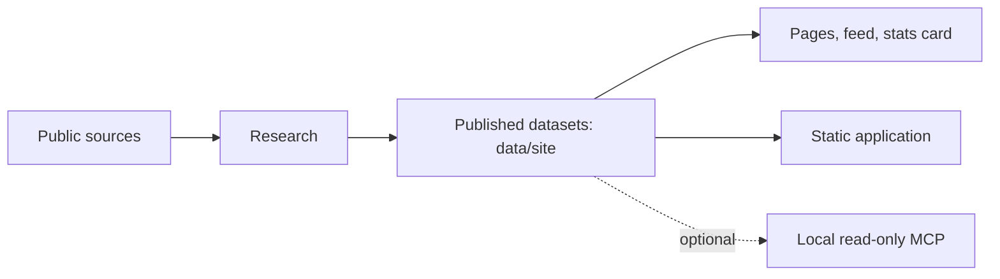

# Architecture

- **This repository** runs on the published datasets only: the static app (`web/`), the page, feed and stats renderers (`backend/tools/`), the local MCP, and the data validator and assembly (`tools/`).
- **Quotes:** `backend/airstack/quotes.py` keeps a fact only if its quote, every listed name and every number is on the text of its own page.
- **Publication** is an allowlist (`config/published-files.json`), parsed and checksummed (`tools/validate_published_data.py`, `data-manifest.json`).
- **Serving** is static, plus one Worker (`worker/`) that keeps the daily counts and the optional accounts listed on [Terms and privacy](https://airstack.bot/legal/). No third-party script. Without an account no cookie is set and your stack stays in browser storage; signing in sets a cookie and saves your stack to your account.
