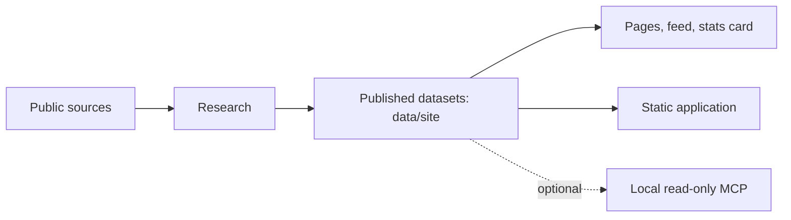

# Architecture

- **This repository** runs on the published datasets only: the static app (`web/`), the page, feed and stats renderers (`backend/tools/`), the local MCP, and the data validator and assembly (`tools/`).
- **The method is public:** `backend/airstack/quotes.py` keeps a fact only if its quote, every listed name and every number is on the text of its own page.
- **Research is private:** fetching, saved responses, the evidence database and the builders that produce `data/site` live in a separate operations repository that imports this package.
- **Publication** is an allowlist (`config/published-files.json`), parsed and checksummed (`tools/validate_published_data.py`, `data-manifest.json`).
- **Serving** is static: no server code, no third-party script, and your stack stays in browser storage.
