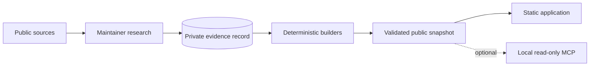

# Architecture

AirStack separates research, publication and serving.

- **Research** runs only from maintainer tools. Visitors cannot start a fetch, model call or data mutation.
- **The evidence record** keeps facts, quotes, source dates and change observations outside the public deployment.
- **Builders** turn reviewed records into inert data. They make no model call.
- **Publication** uses a declared file allowlist, size and type checks, content parsing and checksums. A complete snapshot replaces the prior one atomically.
- **The application** is static HTML, CSS and native JavaScript. Your Stack stays in browser storage. No third-party analytics script runs.
- **MCP** runs locally over stdio against reviewed data.

Provider and production account configuration stays in the private operator record.
